# CostumeCloset Theatre – Costume Hire Management REST API

**CostumeCloset Theatre** is a RESTful backend web service built with **Node.js**, **Express.js**, and **SQLite** to manage theatre costume hires. Developed for **Backend Development Fundamentals (Group Assignment – 01)**, it records actors, costumes, and hire periods, supports full CRUD operations, and helps staff find costumes available on a chosen date.

---

## Project Identity

| Attribute | Details |
|---|---|
| **Project Name** | CostumeCloset Theatre |
| **Assignment** | Group Assignment – 01 |
| **Group Number** | Group 08 |
| **Group Code** | `YG-CSE2E-G08` |
| **Course** | Backend Development Fundamentals |
| **Programme** | B.Tech – Computer Science and Engineering |
| **Academic Level** | Year II |
| **Project Type** | Backend Development / REST API |
| **Application Domain** | Theatre Costume Hire Management |
| **Institution** | AURORA DEEMED UNIVERSITY |
| **Faculty / Instructor** | To be confirmed |
| **Academic Year / Term** | To be confirmed |
| **Submission Date** | To be confirmed |

---

## Project Links

| Platform | Link |
|---|---|
| GitHub Repository | To be provided |
| Live Application (Render) | To be provided if deployed |
| API Base URL | `http://localhost:3000` |
| Server Check | `GET http://localhost:3000/` |

---

## Table of Contents

- [Project Identity](#project-identity)
- [Project Links](#project-links)
1. [Project Overview](#1-project-overview)
2. [Technology Stack](#2-technology-stack)
3. [Project Structure](#3-project-structure)
4. [System Architecture](#4-system-architecture)
5. [Database Documentation](#5-database-documentation)
6. [Complete REST API Documentation](#6-complete-rest-api-documentation)
7. [Search Functionality](#7-search-functionality)
8. [Costume Availability](#8-costume-availability)
9. [Validation and Error Handling](#9-validation-and-error-handling)
10. [Installation and Execution](#10-installation-and-execution)
- [Deployment Information](#deployment-information)
11. [Testing and Screenshots](#11-testing-and-screenshots)
12. [Group Members and Individual Contributions](#12-group-members-and-individual-contributions)
13. [Learning Outcomes](#13-learning-outcomes)
14. [Project Scope and Limitations](#14-project-scope-and-limitations)
15. [Conclusion](#15-conclusion)

---

## 1. Project Overview

### Background

Theatre staff assign costumes to actors before shows. With paper records, staff may struggle to find who has a costume, when it is due back, or whether it is already assigned for the next show.

### Problem Statement

- **Costume assignments are hard to trace.** Actor and costume details may be recorded separately.
- **Hire dates are difficult to compare.** Staff need to check existing assignments to see whether a costume is booked on the requested date.
- **Manual searches take time.** Finding costumes by historical era or retrieving past hire details requires scanning records.

### Proposed Solution

The API stores actors, costumes, and hires in a relational SQLite database. It exposes JSON endpoints to maintain each record type, filter costumes by era, check availability on a given date, and show each hire with its actor and costume names.

### Project Objectives

1. Maintain actor, costume, and hire records through REST endpoints.
2. Track the start and end dates of each hire.
3. Search the costume inventory by era.
4. Find costumes available on a requested date.
5. Retrieve hire details through SQL joins.
6. Validate IDs, required fields, dates, and related records before writing changes.

### Project Scope

The project provides a backend API for local use in Postman and other HTTP clients. It covers Modules 1–3 of Backend Development Fundamentals, including Express fundamentals, relational database operations, REST endpoints, and validation.

### Intended Users

- **Theatre staff** who manage the costume inventory and record assignments.
- **Student developers and evaluators** who run and test the API.

### Main Functionalities

| Function | Description |
|---|---|
| Actor management | Create, list, retrieve, update, and delete actor records |
| Costume management | Create, list, retrieve, update, and delete costume records |
| Hire management | Create, list, retrieve, update, and delete costume assignments |
| Era search | Match costumes by historical era, ignoring letter case |
| Date-based availability | Exclude costumes whose hire dates cover the requested day |
| Hire details | Show actor and costume names alongside their IDs and hire dates |

### Expected Benefits

Staff can look up assignments and check availability from the same inventory. The stored hire dates support scheduling checks and the joined records make assignments easier to review.

---

## 2. Technology Stack

| Technology | Purpose |
|---|---|
| Node.js | Runs the JavaScript backend |
| Express.js 4 | Handles HTTP routes and JSON request bodies |
| SQLite | Stores data in a local database file |
| `sqlite3` | Runs SQL queries from Node.js |
| Postman | Sends requests and verifies API responses |
| Newman | Runs the Postman collection from the command line |

---

## 3. Project Structure

```text
CostumeCloset Theatre/
├── database/
│   └── costume_closet.db
├── routes/
│   ├── actorRoutes.js
│   ├── costumeRoutes.js
│   └── hireRoutes.js
├── postman/
│   ├── CostumeCloset.postman_collection.json
│   ├── POSTMAN_TEST_REPORT.md
│   └── newman-report.json
├── screenshots/
├── db.js
├── server.js
├── package.json
├── package-lock.json
├── .gitignore
└── README.md
```

### File and Module Responsibilities

| File | Responsibility |
|---|---|
| `server.js` | Configures Express, mounts the routers, initializes the database, and starts the server |
| `db.js` | Opens SQLite, enables foreign keys, creates tables, and seeds empty actor and costume tables |
| `routes/actorRoutes.js` | Implements actor CRUD and validates actor IDs and names |
| `routes/costumeRoutes.js` | Implements costume CRUD, era search, and date-based availability |
| `routes/hireRoutes.js` | Implements hire CRUD, date validation, and joined hire reporting |
| `postman/CostumeCloset.postman_collection.json` | Stores reusable API requests and test assertions |
| `postman/POSTMAN_TEST_REPORT.md` | Summarizes the recorded integration test run |
| `postman/newman-report.json` | Stores the machine-readable test report |

---

## 4. System Architecture

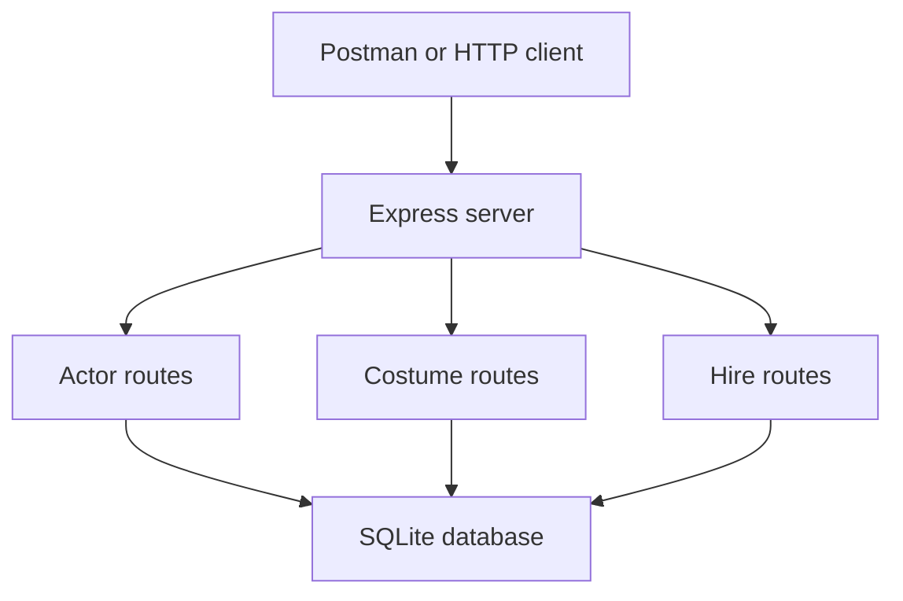

### Module Interactions and Separation of Concerns

Express parses JSON and sends requests to the router for the matching URL. The router validates request values, calls SQLite through the shared database connection, and returns an HTTP status and, where applicable, a JSON response.

### Architectural Layer and Component Responsibilities

| Layer | Responsibility |
|---|---|
| HTTP | Parses JSON, dispatches requests, and handles unknown routes |
| Resource routes | Applies input validation and resource-specific behavior |
| Data access | Executes parameterized SQL for lookups and writes |
| Storage | Stores actors, costumes, and hires with foreign-key relationships |

---

## 5. Database Documentation

### Entity-Relationship Diagram

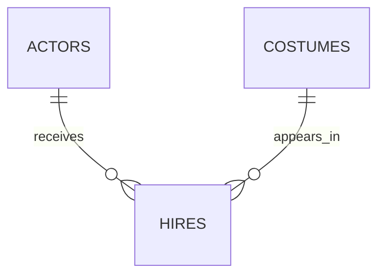

### Table Schemas

#### 1. `actors`

| Column | Type | Constraints |
|---|---|---|
| `id` | INTEGER | Primary key, autoincrement |
| `name` | TEXT | Required |

#### 2. `costumes`

| Column | Type | Constraints |
|---|---|---|
| `id` | INTEGER | Primary key, autoincrement |
| `name` | TEXT | Required |
| `era` | TEXT | Required |

#### 3. `hires`

| Column | Type | Constraints |
|---|---|---|
| `id` | INTEGER | Primary key, autoincrement |
| `actor_id` | INTEGER | Required, references `actors.id` |
| `costume_id` | INTEGER | Required, references `costumes.id` |
| `start_date` | TEXT | Required, API expects `YYYY-MM-DD` |
| `end_date` | TEXT | Required, API expects `YYYY-MM-DD` |

### Relational Integrity and Design Rationale

- An actor can have multiple hires. A costume can appear in multiple hires over time.
- Each hire references one actor and one costume. SQLite foreign-key enforcement prevents deletion of a referenced actor or costume while the hire exists.
- The API stores dates in `YYYY-MM-DD` format, so SQL text comparisons follow chronological order for the supported dates.
- Empty actor and costume tables are seeded with 10 actors and 15 costumes.

### SQL JOIN for Hire Details

```sql
SELECT
  hires.id,
  hires.actor_id,
  actors.name AS actor_name,
  hires.costume_id,
  costumes.name AS costume_name,
  hires.start_date,
  hires.end_date
FROM hires
JOIN actors ON hires.actor_id = actors.id
JOIN costumes ON hires.costume_id = costumes.id
```

---

## 6. Complete REST API Documentation

### Endpoint Summary

The local base URL is `http://localhost:3000`. Send `Content-Type: application/json` for POST and PUT requests. Example IDs and list contents depend on the current database. Each route can return `500` if a server error occurs.

| Method | Endpoint | Purpose | Status codes |
|---|---|---|---|
| GET | `/` | Check that the API is running | 200 |
| GET | `/actors` | List all actors | 200 |
| GET | `/actors/:id` | Get an actor by ID | 200, 400, 404 |
| POST | `/actors` | Create an actor | 201, 400 |
| PUT | `/actors/:id` | Update an actor’s name | 200, 400, 404 |
| DELETE | `/actors/:id` | Delete an actor who has no hire records | 204, 400, 404 |
| GET | `/costumes` | List all costumes or filter by era with `?era=Victorian` | 200 |
| GET | `/costumes/available` | List costumes available on the required `date` query parameter | 200, 400 |
| GET | `/costumes/:id` | Get a costume by ID | 200, 400, 404 |
| POST | `/costumes` | Add a costume | 201, 400 |
| PUT | `/costumes/:id` | Update a costume’s name and era | 200, 400, 404 |
| DELETE | `/costumes/:id` | Delete a costume that has no hire records | 204, 400, 404 |
| GET | `/hires` | List hire records with actor and costume IDs | 200 |
| GET | `/hires/details` | List hire records with actor and costume names from a SQL JOIN | 200 |
| GET | `/hires/:id` | Get a hire record by ID | 200, 400, 404 |
| POST | `/hires` | Assign a costume to an actor for a date range | 201, 400, 404 |
| PUT | `/hires/:id` | Replace a hire’s actor, costume and date range | 200, 400, 404 |
| DELETE | `/hires/:id` | Delete a hire record | 204, 400, 404 |

### Server Check

#### `GET /`

Check that the API is running.

**Example request**

```http
GET /
```

**Example response (200)**

```json
{
  "message": "Welcome to CostumeCloset Theatre API"
}
```

### Actors Endpoints

#### `GET /actors`

List all actors.

**Example request**

```http
GET /actors
```

**Example response (200)**

```json
[
  {
    "id": 1,
    "name": "John"
  }
]
```

#### `GET /actors/:id`

Get an actor by ID.

**Example request**

```http
GET /actors/1
```

**Example response (200)**

```json
{
  "id": 1,
  "name": "John"
}
```

**Other client responses** `400`, `404`. See [Validation and Error Handling](#9-validation-and-error-handling).

#### `POST /actors`

Create an actor.

**Example request**

```http
POST /actors
Content-Type: application/json

{
  "name": "Alex"
}
```

**Example response (201)**

```json
{
  "id": 11,
  "name": "Alex"
}
```

**Other client responses** `400`. See [Validation and Error Handling](#9-validation-and-error-handling).

#### `PUT /actors/:id`

Update an actor’s name.

**Example request**

```http
PUT /actors/11
Content-Type: application/json

{
  "name": "Alex Morgan"
}
```

**Example response (200)**

```json
{
  "id": 11,
  "name": "Alex Morgan"
}
```

**Other client responses** `400`, `404`. See [Validation and Error Handling](#9-validation-and-error-handling).

#### `DELETE /actors/:id`

Delete an actor who has no hire records.

**Example request**

```http
DELETE /actors/11
```

**Example response (204)**

The response body is empty.

**Other client responses** `400`, `404`. See [Validation and Error Handling](#9-validation-and-error-handling).

### Costumes Endpoints

#### `GET /costumes`

List all costumes or filter by era with `?era=Victorian`.

**Example request**

```http
GET /costumes
```

**Example response (200)**

```json
[
  {
    "id": 15,
    "name": "Costume 15",
    "era": "Victorian"
  }
]
```

#### `GET /costumes/available`

List costumes available on the required `date` query parameter.

**Example request**

```http
GET /costumes/available?date=2026-11-11
```

**Example response (200)**

```json
[
  {
    "id": 3,
    "name": "Knight Armor",
    "era": "Medieval"
  }
]
```

**Other client responses** `400`. See [Validation and Error Handling](#9-validation-and-error-handling).

#### `GET /costumes/:id`

Get a costume by ID.

**Example request**

```http
GET /costumes/15
```

**Example response (200)**

```json
{
  "id": 15,
  "name": "Costume 15",
  "era": "Victorian"
}
```

**Other client responses** `400`, `404`. See [Validation and Error Handling](#9-validation-and-error-handling).

#### `POST /costumes`

Add a costume.

**Example request**

```http
POST /costumes
Content-Type: application/json

{
  "name": "Stage Cloak",
  "era": "Medieval"
}
```

**Example response (201)**

```json
{
  "id": 16,
  "name": "Stage Cloak",
  "era": "Medieval"
}
```

**Other client responses** `400`. See [Validation and Error Handling](#9-validation-and-error-handling).

#### `PUT /costumes/:id`

Update a costume’s name and era.

**Example request**

```http
PUT /costumes/16
Content-Type: application/json

{
  "name": "Royal Cloak",
  "era": "Medieval"
}
```

**Example response (200)**

```json
{
  "id": 16,
  "name": "Royal Cloak",
  "era": "Medieval"
}
```

**Other client responses** `400`, `404`. See [Validation and Error Handling](#9-validation-and-error-handling).

#### `DELETE /costumes/:id`

Delete a costume that has no hire records.

**Example request**

```http
DELETE /costumes/16
```

**Example response (204)**

The response body is empty.

**Other client responses** `400`, `404`. See [Validation and Error Handling](#9-validation-and-error-handling).

### Hires Endpoints

#### `GET /hires`

List hire records with actor and costume IDs.

**Example request**

```http
GET /hires
```

**Example response (200)**

```json
[
  {
    "id": 1,
    "actor_id": 1,
    "costume_id": 15,
    "start_date": "2026-11-10",
    "end_date": "2026-11-12"
  }
]
```

#### `GET /hires/details`

List hire records with actor and costume names from a SQL JOIN.

**Example request**

```http
GET /hires/details
```

**Example response (200)**

```json
[
  {
    "id": 1,
    "actor_id": 1,
    "actor_name": "John",
    "costume_id": 15,
    "costume_name": "Costume 15",
    "start_date": "2026-11-10",
    "end_date": "2026-11-12"
  }
]
```

#### `GET /hires/:id`

Get a hire record by ID.

**Example request**

```http
GET /hires/1
```

**Example response (200)**

```json
{
  "id": 1,
  "actor_id": 1,
  "costume_id": 15,
  "start_date": "2026-11-10",
  "end_date": "2026-11-12"
}
```

**Other client responses** `400`, `404`. See [Validation and Error Handling](#9-validation-and-error-handling).

#### `POST /hires`

Assign a costume to an actor for a date range.

**Example request**

```http
POST /hires
Content-Type: application/json

{
  "actor_id": 1,
  "costume_id": 15,
  "start_date": "2026-11-10",
  "end_date": "2026-11-12"
}
```

**Example response (201)**

```json
{
  "id": 1,
  "actor_id": 1,
  "costume_id": 15,
  "start_date": "2026-11-10",
  "end_date": "2026-11-12"
}
```

**Other client responses** `400`, `404`. See [Validation and Error Handling](#9-validation-and-error-handling).

#### `PUT /hires/:id`

Replace a hire’s actor, costume and date range.

**Example request**

```http
PUT /hires/1
Content-Type: application/json

{
  "actor_id": 1,
  "costume_id": 15,
  "start_date": "2026-11-10",
  "end_date": "2026-11-13"
}
```

**Example response (200)**

```json
{
  "id": 1,
  "actor_id": 1,
  "costume_id": 15,
  "start_date": "2026-11-10",
  "end_date": "2026-11-13"
}
```

**Other client responses** `400`, `404`. See [Validation and Error Handling](#9-validation-and-error-handling).

#### `DELETE /hires/:id`

Delete a hire record.

**Example request**

```http
DELETE /hires/1
```

**Example response (204)**

The response body is empty.

**Other client responses** `400`, `404`. See [Validation and Error Handling](#9-validation-and-error-handling).

---

## 7. Search Functionality

### How Era Search Works

`GET /costumes?era=Victorian` returns costumes whose era matches the query value regardless of letter case. For example, `era=victorian` and `era=Victorian` return the same matches. An unknown era returns `[]`. Calling `GET /costumes` without an era returns the full inventory.

```sql
SELECT * FROM costumes WHERE LOWER(era) = LOWER(?)
```

The query binds the era as a parameter. Matching uses the full era value.

---

## 8. Costume Availability

### How the Availability Check Works

`GET /costumes/available?date=YYYY-MM-DD` checks the requested day against every hire for each costume. A hire covers the requested day when `start_date <= requested_date` and `end_date >= requested_date`. Both endpoints of the date range are inclusive.

```sql
SELECT * FROM costumes
WHERE NOT EXISTS (
  SELECT 1 FROM hires
  WHERE hires.costume_id = costumes.id
    AND hires.start_date <= ?
    AND hires.end_date >= ?
)
```

### Worked Availability Example

Assume Costume 15 has one hire from 10 November to 12 November 2026.

| Requested date | Result for Costume 15 |
|---|---|
| `2026-11-10` | Excluded from the available list |
| `2026-11-11` | Excluded from the available list |
| `2026-11-12` | Excluded from the available list |
| `2026-11-13` | Included in the available list |

---

## 9. Validation and Error Handling

| Input or condition | Validation rule |
|---|---|
| Route ID and hire IDs | Require positive integers |
| Actor name, costume name, and era | Require non-empty strings and trim leading and trailing whitespace before saving |
| Hire start and end dates | Require real calendar dates in `YYYY-MM-DD` format |
| Hire date order | Require `end_date` to be on or after `start_date` |
| Hire references | Require the actor and costume to exist |
| Availability date | Require a valid `date` query parameter |
| Actor or costume deletion | Return `400` if an existing hire references the record |

**Example invalid hire response (400)**

```json
{ "error": "End date cannot be earlier than start date" }
```

### HTTP Status Codes Reference

| Status | Meaning |
|---|---|
| `200 OK` | Successful read or update |
| `201 Created` | New resource created |
| `204 No Content` | Resource deleted |
| `400 Bad Request` | Invalid input or a foreign-key constraint blocks deletion |
| `404 Not Found` | A requested record, referenced record, or route is missing |
| `500 Internal Server Error` | An internal operation failed |

---

## 10. Installation and Execution

### 1. Prerequisites

Install Node.js with npm. Postman is used to run the included API collection.

### 2. Open the Project Folder

Open the CostumeCloset Theatre folder in a terminal. Run the following commands from the folder that contains `package.json`.

### 3. Install Dependencies

```bash
npm ci
```

### 4. Start the Backend Locally

```bash
npm start
```

The server starts on port `3000` and uses `database/costume_closet.db`.

### 5. Check the Local Server

```bash
curl http://localhost:3000/
```

Expected response.

```json
{ "message": "Welcome to CostumeCloset Theatre API" }
```

### 6. Test the API

Import the Postman collection and keep `baseUrl` set to `http://localhost:3000`. Run the assignment scenarios listed below.

### 7. Stop the Server

Press `Ctrl+C` in the server terminal.

---

## Deployment Information

| Item | Configuration |
|---|---|
| Local runtime | Node.js |
| Install command | `npm ci` |
| Start command | `npm start` |
| Server port | `3000` |
| Public deployment URL | To be provided if deployed |

### SQLite Persistence Considerations

When deploying, ensure the directory that holds the SQLite database is writable and backed by persistent storage. The current server uses a fixed port of `3000`.

---

## 11. Testing and Screenshots

### Postman Collection and Automated Test Suite

The [recorded test report](postman/POSTMAN_TEST_REPORT.md) and [Newman output](postman/newman-report.json) show **48 requests and 81 passing assertions**. The collection sends write requests, so use a test copy of the database when running the full suite.

#### Running the Automated Test Suite

Start the server first, then run the collection from the project root.

```bash
npx newman run postman/CostumeCloset.postman_collection.json
```

#### Postman Folder Structure

| Folder | Requests |
|---|---:|
| 1 - Actors CRUD | 6 |
| 2 - Costumes CRUD | 10 |
| 3 - Hires CRUD | 7 |
| 4 - Input Validation | 17 |
| 5 - Foreign Key Protection | 4 |
| 6 - Mandatory Assignment Tests | 4 |

#### Importing and Running in Postman

1. In Postman, select **Import** and open [CostumeCloset.postman_collection.json](postman/CostumeCloset.postman_collection.json).
2. Check that the collection variable `baseUrl` points to the running server.
3. Run **6 - Mandatory Assignment Tests** in its saved order. The collection creates the hire used by the availability checks.

### Mandatory Assignment Tests

| Test | Request or action | Expected result |
|---|---|---|
| 1. Reject reversed dates | Send `POST /hires` with actor `1`, costume `15`, start date `2026-11-15`, and end date `2026-11-10` | `400` with `End date cannot be earlier than start date` |
| 2. Exclude a hired costume | Hire costume `15` for actor `1` from `2026-11-10` to `2026-11-12`. Check `GET /costumes/available?date=2026-11-11` | Setup returns `201`. Availability returns `200` and omits Costume 15 |
| 3. Include the costume after the hire ends | Check `GET /costumes/available?date=2026-11-13` | `200` with Costume 15 in the list, assuming no other hire covers that date |

### Screenshot Gallery

#### Project Setup

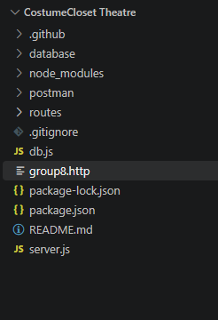

*Figure 1 (`01-project-structure.png`). Project structure in VS Code Explorer for CostumeCloset Theatre.*

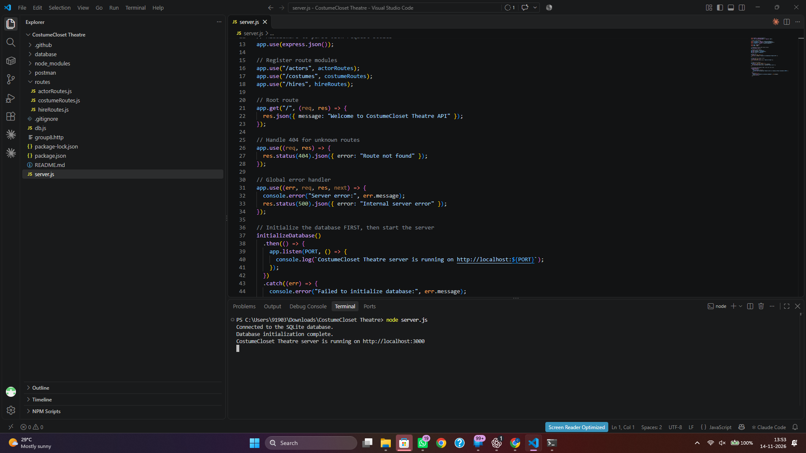

*Figure 2 (`02-server-startup.png`). Successful startup with `node server.js`, including the SQLite connection and the server listening on `http://localhost:3000`.*

#### API Responses

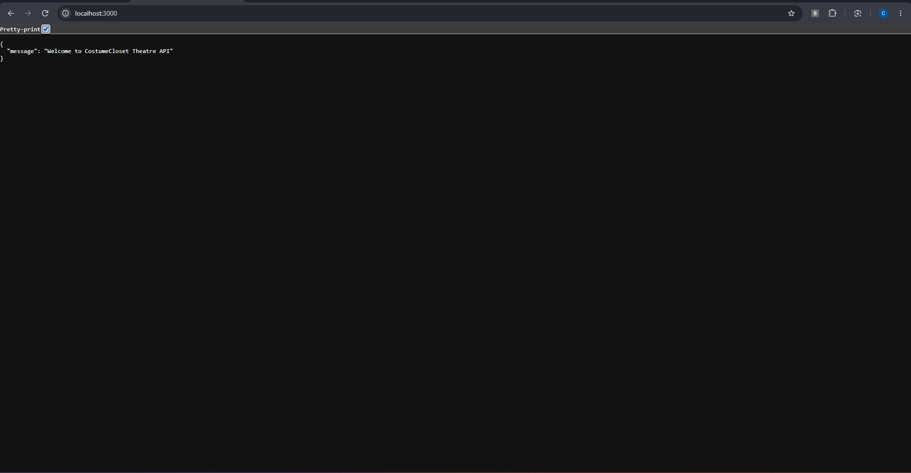

*Figure 3 (`03-api-welcome.png`). `GET /` displays the CostumeCloset Theatre API welcome message.*

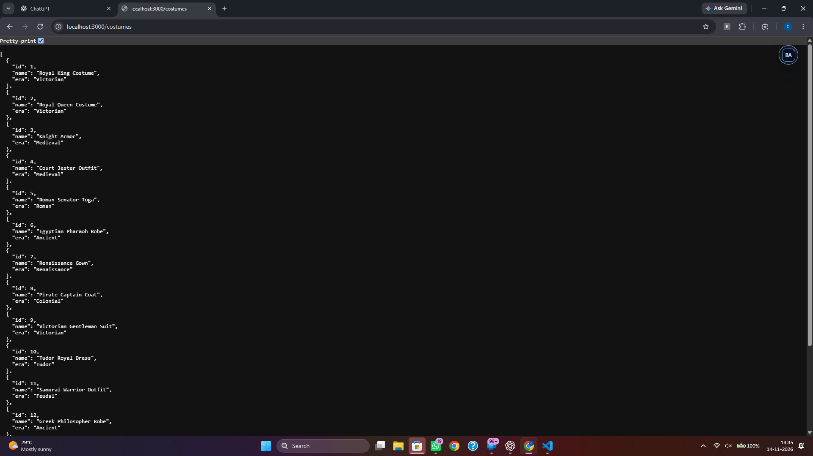

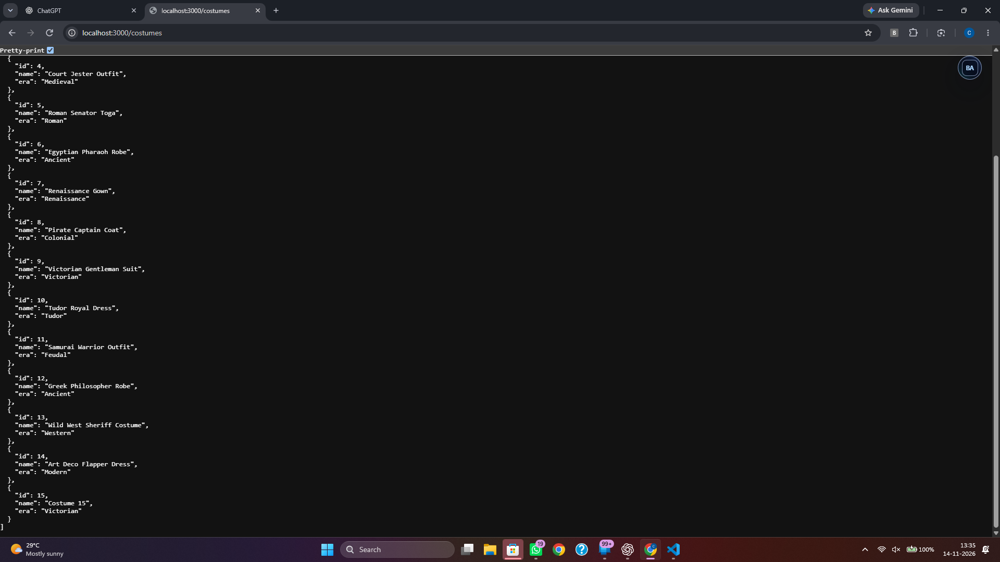

*Figure 4 (`04-get-costumes.png`). `GET /costumes` lists the 15 costumes. The two captures show the start and end of the response.*

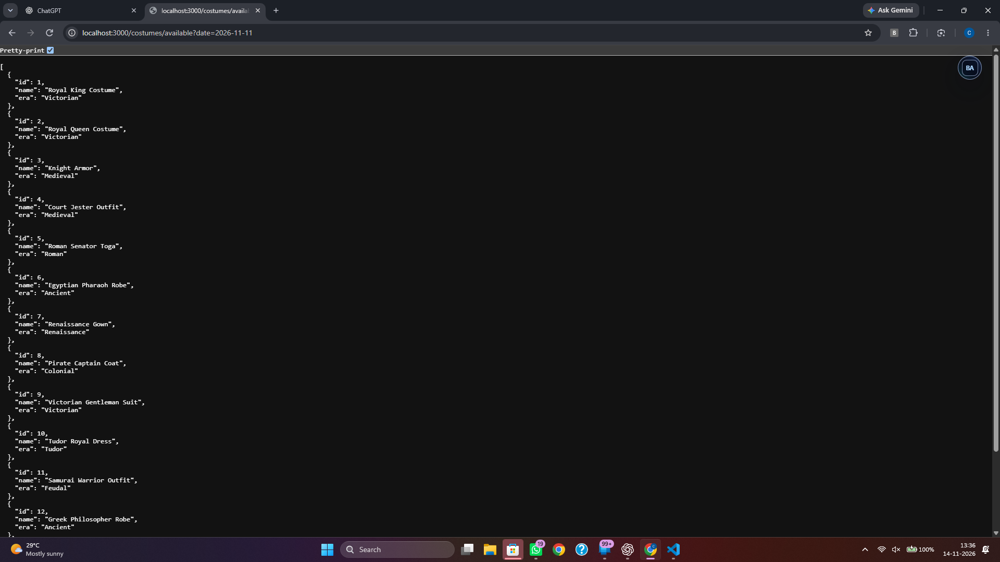

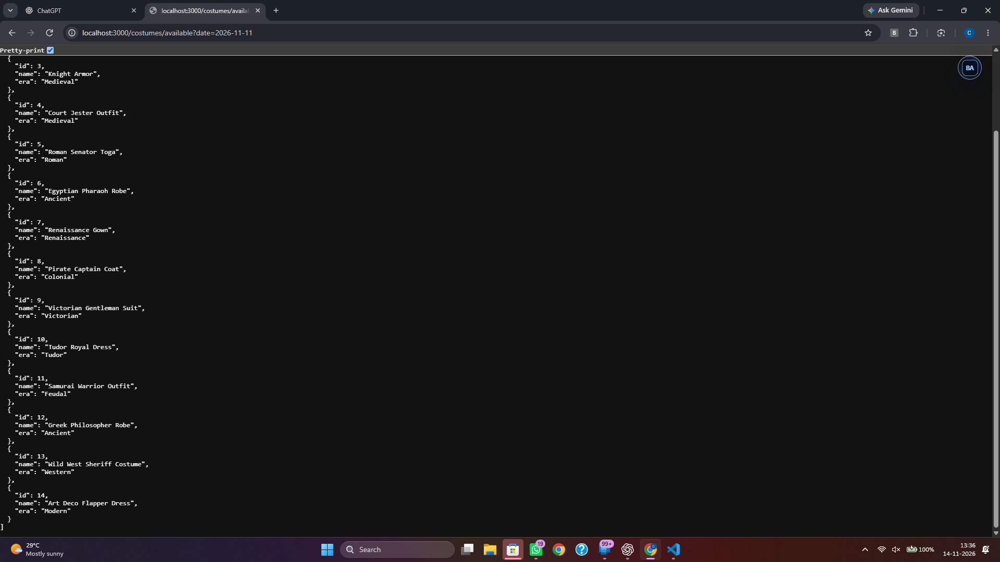

*Figure 5 (`05-costume-15-unavailable.png`). `GET /costumes/available?date=2026-11-11` excludes Costume 15 during its November 10–12 hire. The two captures show the start and end of the response.*

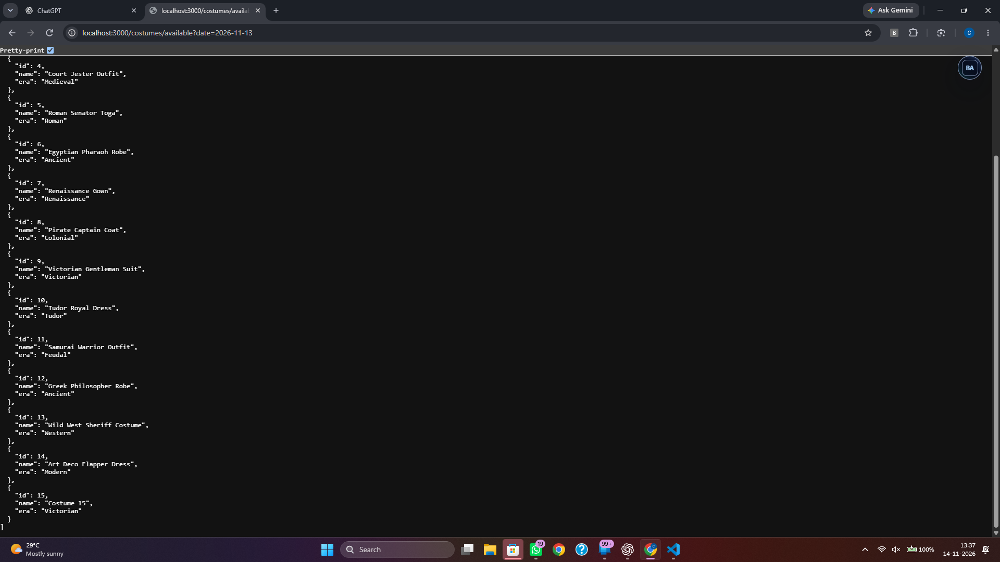

*Figure 6 (`06-costume-15-available.png`). `GET /costumes/available?date=2026-11-13` includes Costume 15 after the hire ends.*

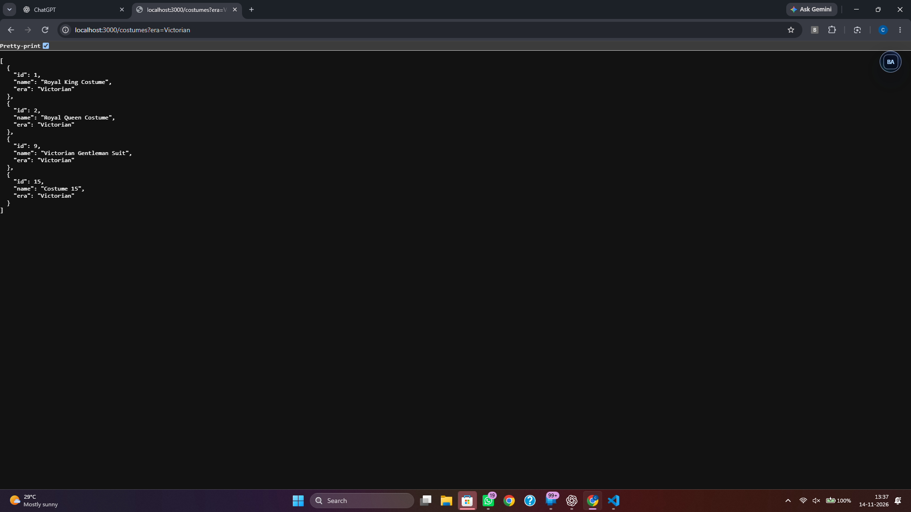

*Figure 7 (`07-costumes-victorian.png`). `GET /costumes?era=Victorian` returns four costumes in the Victorian era.*

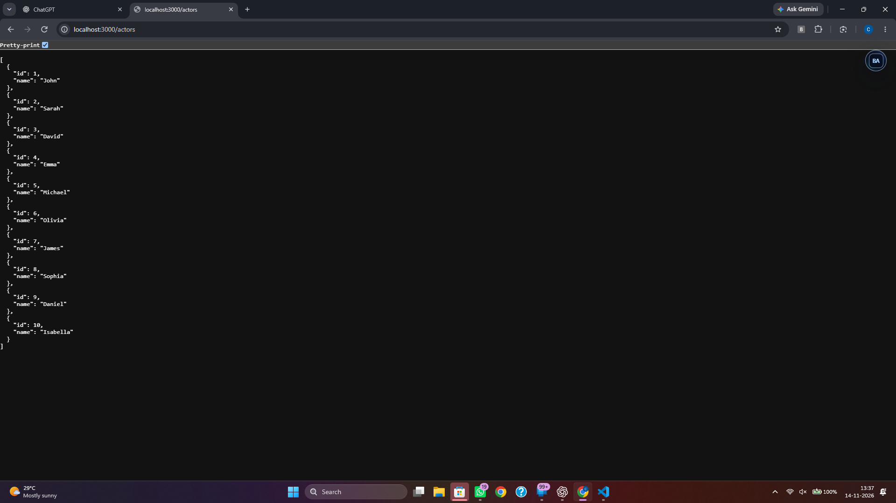

*Figure 8 (`08-get-actors.png`). `GET /actors` returns 10 actor records with IDs and names.*

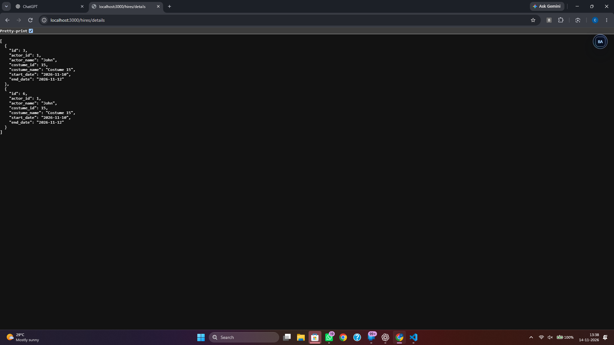

*Figure 9 (`09-hires-join.png`). `GET /hires/details` shows the joined `actor_name` and `costume_name` alongside the hire dates.*

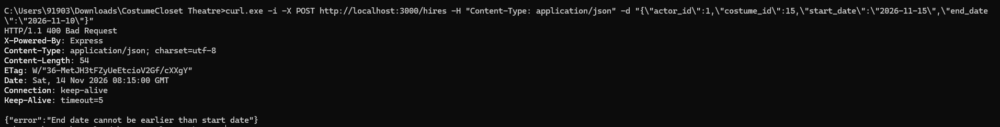

*Figure 10 (`10-hire-date-validation.png`). `POST /hires` returns `400 Bad Request` and the error `End date cannot be earlier than start date` for reversed dates.*

#### Read-Only SQLite Verification

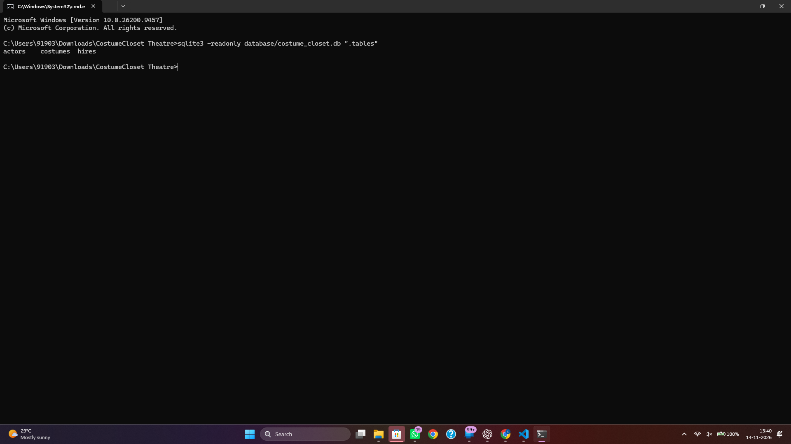

*Figure 11 (`11-database-tables.png`). The SQLite `.tables` command lists `actors`, `costumes`, and `hires`.*

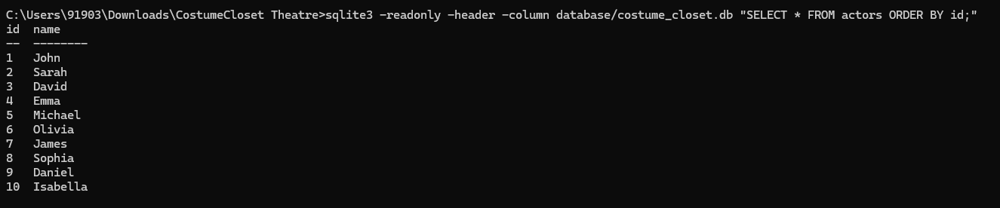

*Figure 12 (`12-actors-records.png`). `SELECT * FROM actors ORDER BY id;` shows 10 actor records.*

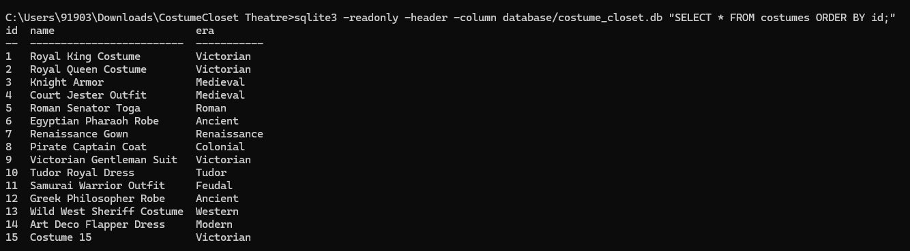

*Figure 13 (`13-costumes-records.png`). `SELECT * FROM costumes ORDER BY id;` shows 15 costume records.*

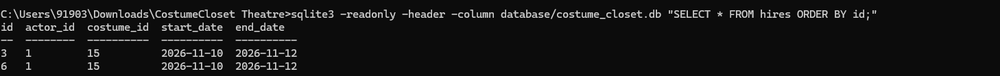

*Figure 14 (`14-hires-records.png`). `SELECT * FROM hires ORDER BY id;` shows the two hire records present at the time of capture.*

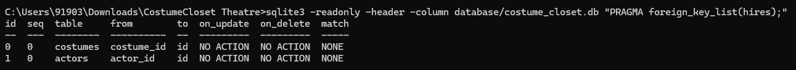

*Figure 15 (`15-database-relationships.png`). `PRAGMA foreign_key_list(hires);` shows foreign keys to `actors(id)` and `costumes(id)`.*

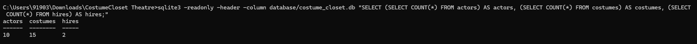

*Figure 16 (`16-database-record-counts.png`). The count query shows 10 actors, 15 costumes, and 2 hires at the time of capture.*

---

## 12. Group Members and Individual Contributions

### Member-Wise Contribution and Ownership Guide

| Member Name | Roll Number | Responsibility from the project’s existing README |
|---|---|---|
| To be provided | To be provided | Server setup and route registration |
| To be provided | To be provided | Database setup and SQL queries |
| To be provided | To be provided | CRUD endpoints and SQL JOIN |
| To be provided | To be provided | Input validation and era search |
| To be provided | To be provided | Date-based availability rule and assignment tests |
| To be provided | To be provided | Postman collection and README |

### Teamwork and Integration

Enter the actual ownership and individual contribution for each group member before submission. The responsibilities shown above are taken from the project’s existing draft.

---

## 13. Learning Outcomes

- Build Express routers and return appropriate HTTP status codes for CRUD operations.
- Design related SQLite tables and enforce foreign-key constraints.
- Use parameterized queries, date comparisons, and joins to answer practical questions.
- Validate incoming data and test success and error responses in Postman and Newman.

---

## 14. Project Scope and Limitations

### Current Scope (Implemented)

Actor, costume, and hire CRUD, relational storage, case-insensitive era search, date-based availability, and hire reporting through SQL joins.

### Current Limitations

- The API has no frontend or user authentication.
- List routes return the matching records in one response.
- The availability endpoint reports existing hires. The create and update routes can still accept overlapping hire dates for the same costume.
- The system stores planned hire dates. It does not store actual return dates or send overdue reminders.

### Possible Future Enhancements

Add overlapping-hire validation, actual return tracking, overdue reminders, and pagination for larger inventories.

---

## 15. Conclusion

CostumeCloset Theatre gives theatre staff a central record of actors, costumes, and hires. It uses SQLite relationships to show who has each costume and date-range queries to tell staff whether a costume is available on a requested day.

